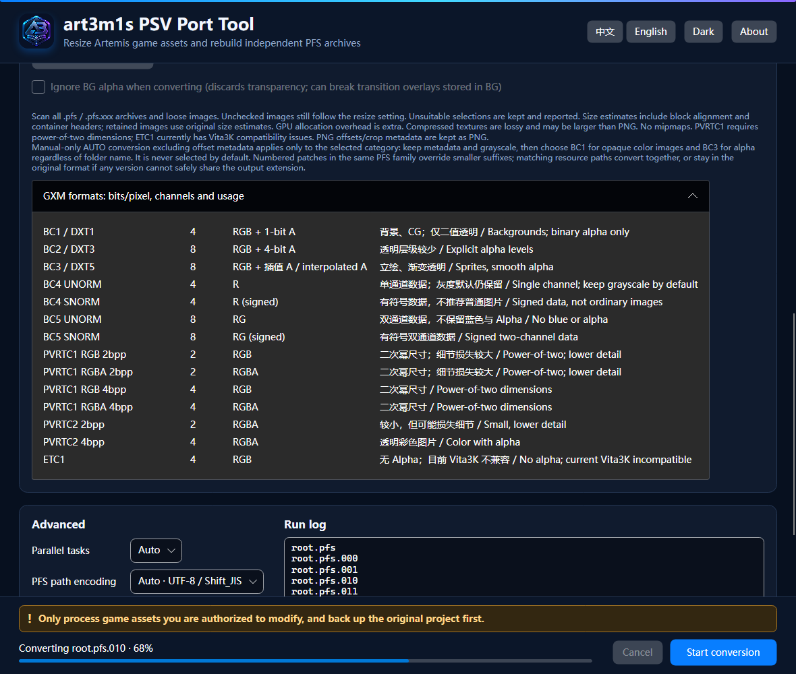

# art3m1s_psv_port_tool

[简体中文](README.md) · [English](README.en.md) · [Changelog](CHANGELOG.md)

[](https://github.com/DeQxJ00/Art3m1sPsvPortTool/actions/workflows/ci.yml)
[](https://github.com/DeQxJ00/Art3m1sPsvPortTool/actions/workflows/release.yml)

A PSV porting assistant for Artemis-engine games. It extracts each physical PFS independently, resizes selected assets, and rebuilds it under the exact same file name. Arbitrarily named loose directories under the game root are copied recursively and their assets are converted by file extension (tested at three levels and with no depth limit in the implementation). The app uses .NET 10, Avalonia 12, C# 14, and NativeAOT on Windows, Linux, and macOS.

> Only process game assets you are authorized to modify, and keep a backup. This tool does not bypass platform signing, licensing encryption, or DRM.

## UI screenshots



[中文深色](docs/screenshots/ui-zh-CN-dark.png) · [English dark](docs/screenshots/ui-en-US-dark.png) · [中文浅色](docs/screenshots/ui-zh-CN-light.png) · [English light](docs/screenshots/ui-en-US-light.png)

## Downloads and platform support

Every release provides two versioned archives for each of `win-x64`, `linux-x64`, `osx-x64`, and `osx-arm64`: `with-ffmpeg` works out of the box, while the smaller `no-ffmpeg` archive requires FFmpeg to be supplied separately. Windows/Linux use a NativeAOT executable with a separate PVRTexLib native library; macOS uses an unsigned and unnotarized `.app.zip` bundle and may require manual approval under Privacy & Security.

### Installing FFmpeg

Video and OGV conversion require both `ffmpeg` and `ffprobe`. The `with-ffmpeg` archive already places them correctly. For a `no-ffmpeg` archive, use a GPL Full build containing libdav1d, libx264, and libtheora, then choose one of these configurations:

- Windows/Linux: create a `tools` folder beside the application and place `ffmpeg.exe` / `ffprobe.exe` (Windows) or `ffmpeg` / `ffprobe` (Linux) inside it. They may also be placed directly beside the application.
- macOS: place both files in `art3m1s_psv_port_tool.app/Contents/MacOS/tools/` and make them executable (`chmod +x ffmpeg ffprobe`).
- Every platform: set `ART3M1S_FFMPEG` and `ART3M1S_FFPROBE` to the full paths of the two executables, or add both to the system `PATH`.

Lookup order is environment variables, the application's `tools` directory, beside the application, then system `PATH`. In the supplied Full packages, Windows/Linux use checksum-verified BtbN n9.0 static binaries and macOS uses an equivalent FFmpeg 9.0.2 source build. No nonfree components are enabled.

## Usage

1. Select a game root containing `xxxxx.pfs` and a different output directory.
2. Click “Scan project” to verify the independent PFS count, or “Detect resolution” to list all INI resolutions and select one for the preview.
3. Set Ratio and select Text, Images, Animation, and Video.
4. Start conversion. If output exists, click Start once more to confirm replacement.

The converter writes to a dedicated sibling staging directory and replaces the destination only after every operation succeeds. Cancellation or failure removes temporary output.

## Command-line conversion and batch scripts (cmdline)

One invocation converts **one game**. `--input` is the game root directly containing PFS; `--output` is the exact destination for that game. No parent-directory enumeration or additional game-name folder is added. For example, `D:\resources\sample01\root.pfs` becomes `D:\converted\sample01\root.pfs` with those two game directories passed explicitly.

Starting without arguments opens the GUI. `--help` and `--version` print help/version. CLI mode opens no UI and does not load saved GUI settings. Only modify authorized resources and back up originals first.

### Shared default preset

`--preset ui-defaults` selects the fresh-UI conversion defaults and is also used when omitted. Both entry points use `ConversionDefaults`. CLI mode does not load personalized GUI settings; explicit flags override the preset regardless of where `--preset` appears.

Defaults: Ratio **0.5**; text/images/animation/video enabled; native image textures enabled with recommended AUTO Swizzled categories after scanning; background alpha retained; PSB DXT5 / Swizzled; independent PSB scaling and render compensation disabled; ordinary archived videos ignored; automatic worker count and filename encoding; font subsetting disabled with Simplified Chinese as the default range. Existing-output handling remains a CLI execution policy, controlled separately by `--existing`.

For the test configuration requested—enable only Simplified Chinese font subsetting and leave everything else at defaults—use:

```powershell
.\Art3m1s.PsvTool.App.exe --convert --input "D:\resources\sample01" --output "D:\converted\sample01" --preset ui-defaults --subset-fonts true --font-profile simplified | Out-Host
```

No other switches are needed. Detecting a 720p, 2K or 4K source does not change the default Ratio. Explicitly use `--ratio auto` for the behavior of the GUI's automatic resolution-fit action.

### Convert one game

Windows PowerShell, from the extracted application folder (the pipe displays output and waits for this GUI-subsystem executable):

```powershell
.\Art3m1s.PsvTool.App.exe --help | Out-Host
.\Art3m1s.PsvTool.App.exe --convert --input "D:\resources\sample01" --output "D:\converted\sample01" --dry-run | Out-Host
.\Art3m1s.PsvTool.App.exe --convert --input "D:\resources\sample01" --output "D:\converted\sample01" --ratio 0.5 --subset-fonts false | Out-Host
$LASTEXITCODE
```

Windows CMD can wait for completion with:

```bat
start "" /b /wait "Art3m1s.PsvTool.App.exe" --convert --input "D:\resources\sample01" --output "D:\converted\sample01" --ratio 0.5 --subset-fonts false
echo %ERRORLEVEL%
```

Linux: `./Art3m1s.PsvTool.App --convert --input /data/sample01 --output /data/output/sample01`. macOS: use `.app/Contents/MacOS/Art3m1s.PsvTool.App`. Quote paths containing spaces. `--option=value` and positional `--convert GAME_DIR OUTPUT_DIR` are supported. `--batch-convert` remains an alias for **the same single-game operation**, not a parent-folder batch mode. Checklist and continue-on-error options are not supported.

### Options

| Option | Default / behavior |
| --- | --- |
| `--preset ui-defaults` | Shared fresh-UI conversion defaults; implicit when omitted |
| `--input PATH` / `-i PATH` | Required single game root, directly containing PFS files |
| `--output PATH` / `-o PATH` | Required exact game output directory; no extra nesting; input/output must not overlap |
| `--ratio auto\|R` | `0.5`, matching the initial GUI value; `auto` explicitly enables fitting; explicit numbers must satisfy `0 < R ≤ 1` and use a decimal point |
| `--source-resolution WxH` | Override this game's source size, e.g. `1920x1080`; does not edit sources |
| `--fit WxH` | `960x540`; bounding box for automatic Ratio, preserving aspect ratio |
| `--types LIST` | `all`, `none`, or a comma-separated subset of `text,images,animation,video` |
| `--parallel auto\|N` | `auto` = `max(1, logical CPU cores - 1)`, or a positive integer; workers within this game |
| `--encoding auto\|utf-8\|shift-jis` | `auto`, PFS filename encoding |
| `--native-textures true\|false` | `true`; scan and select recommended ordinary-image categories using safe AUTO rules |
| `--ignore-bg-alpha true\|false` | `false`; discard background-image alpha only when explicitly requested |
| `--psb-format dxt5\|pvrtc2-4\|pvrtc2-2\|preserve` | `dxt5`; `preserve` disables PSB texture-format compression, not global-Ratio resizing when animation is enabled |
| `--dxt5-layout swizzled\|linear` | `swizzled`; ordinary-image automatic recommendations and PSB DXT5 layout |
| `--subset-fonts true\|false` | `false`, matching the GUI; independent of `--types`; pass `false` to retain fonts |
| `--font-profile simplified\|japanese\|traditional` | `simplified`; common Simplified Chinese / Japanese / Traditional Chinese ranges |
| `--ignore-pfs-videos true\|false` | `true`; skip ordinary archived videos, excluding OGV; archived DAT still follows the existing preservation rule |
| `--existing skip\|error\|overwrite` | `skip`; skip, fail, or replace the entire existing output; overwrite has no interactive confirmation |
| `--log PATH` | Custom full UTF-8 append log; defaults group by input game name (below); adjacent `.errors.log` holds warnings/errors |
| `--dry-run` | Preview this game's resolution, Ratio and target size; no conversion, output directories or log writes; not a full texture/video validation |
| `--verbose` | Show every console progress event; file logs always retain all resources and full exceptions, regardless of console throttling |
| `--help` / `-h`, `--version` | Print help / version without conversion |

Auto Ratio prefers `[WINDOWS]` in the first usable `system.ini`, otherwise its first resolution, falling back to detected image dimensions. It computes `min(1, fitWidth/sourceWidth, fitHeight/sourceHeight)` without upscaling; 1920×1080 becomes 0.5. An unknown resolution fails that project unless `--source-resolution 1920x1080` or `--ratio 0.5` is supplied. With only a manual Ratio and no detected size, resources still scale but target INI dimensions cannot be determined in advance. Independent PSB ratios remain disabled; PSB uses the global Ratio.

`--native-textures false` disables ordinary-image native texture compression, not PNG resizing: resizing requires `images` in `--types`. PSB conversion is controlled by `animation` and `--psb-format`. Unselected resources are normally copied unchanged, but missing `[VITA]` sections in `system.ini` are still appended. FFmpeg placement is identical to GUI mode; see above.

### Batch by calling the CLI repeatedly

List each source/destination explicitly; they may live on different drives and use different Ratios. This PowerShell script runs sequentially, reports failures and stops on cancellation. Change the failure branch to `break` if you want to stop at the first error.

```powershell
$tool = ".\Art3m1s.PsvTool.App.exe"
$jobs = @(
    @{ Input = "D:\resources\sample01"; Output = "D:\converted\sample01"; Ratio = "0.5" },
    @{ Input = "E:\source\sample02"; Output = "D:\converted\sample02"; Ratio = "0.75" }
)
$failed = 0
foreach ($job in $jobs) {
    & $tool --convert --input $job.Input --output $job.Output --ratio $job.Ratio --subset-fonts false | Out-Host
    $code = $LASTEXITCODE
    if ($code -ne 0) {
        $failed++
        Write-Warning "Conversion failed: $($job.Input), exit=$code"
        if ($code -eq 130) { break }
    }
}
if ($failed -gt 0) { throw "$failed conversion(s) failed." }
```

A `.cmd` file beside the executable can call two games independently and stop on failure:

```bat
@echo off
start "" /b /wait "%~dp0Art3m1s.PsvTool.App.exe" --convert --input "D:\resources\sample01" --output "D:\converted\sample01" --ratio 0.5 --subset-fonts false
if errorlevel 1 exit /b %ERRORLEVEL%
start "" /b /wait "%~dp0Art3m1s.PsvTool.App.exe" --convert --input "E:\source\sample02" --output "D:\converted\sample02" --ratio 0.75 --subset-fonts false
exit /b %ERRORLEVEL%
```

### Output safety and exit codes

An existing output is skipped by default. Use `--existing error` to fail instead, or `--existing overwrite` to replace the **entire exact output directory** without prompting. The normal core staging and atomic publication mechanism preserves existing output on failure/cancellation and never publishes partial results. Ctrl+C cancels the current conversion; your calling script decides whether another invocation runs.

The lock sits beside the exact output directory, e.g. `result.conversion.lock`. Its exclusive handle prevents concurrent invocations writing to the same output. An acquired lock is deleted on handle close after success, failure, cancellation, skipping or setup failure. A task that cannot acquire it never deletes it, and other tasks' locks are not scanned or removed. Unheld sidecars left by older versions are reclaimed and cleaned on the next invocation for that output, never bulk-deleted. `--dry-run` neither creates nor cleans locks. Custom logs must be outside input/output directories. CLI paths do not support symbolic links/junctions.

Exit codes: `0` success/skip/preview, `1` conversion failure (including a parent directory passed instead of a game root), `2` invalid arguments or path/log/lock setup, `130` cancellation. There is no internal project queue or checklist. Font subsetting defaults to disabled, matching the GUI. Default-configuration conversion acceptance tests explicitly use `--subset-fonts true --font-profile simplified` and leave all other conversion settings at their shared defaults.

### Logs and error diagnosis

Both GUI and CLI conversions (including batch-script invocations) **automatically save full logs by default; `--log` is optional**. Files use the input game directory name, not the output name, under `OUTPUT_PARENT/logs/GAME/`:

```text
D:\converted\logs\sample01\
  sample01.log
  sample01.errors.log
```

- The full `.log` retains every resource, preservation/conversion result, font before/after sizes, effective options, stages, duration and final exit state. Only console progress is throttled; file events are not discarded.
- The application creates a separate `.errors.log` for every conversion without requiring BAT redirection. It contains run boundaries, outcome and warning/error event counts, but excludes ordinary resource progress. Warnings/errors also remain in the full log. Exception types, stack traces, all inner exceptions and original FFmpeg stderr are always retained without `--verbose`. FFmpeg commands and exit codes remain in the full log; failure details, retry warnings and DAT preservation reasons enter the error log.
- Repeated runs append to the same files without overwriting earlier records. Each record includes time, severity, game, unique run ID, stage, PFS (or loose resources) and resource path. Errors from concurrent resource tasks are recorded individually. Run same-named games sharing a log directory sequentially, or specify separate paths with `--log`.
- Ordinary images and E-mote PSB atlases with width or height **over 4096** log original/target dimensions, limit and atlas name. `SOURCE_DIMENSIONS_GT_4096` is informational when downscaling brings the target within the limit; `TARGET_DIMENSIONS_GT_4096` warns when the target still exceeds it. Ratio and cropping are not changed automatically. Oversized ordinary images may remain resized PNGs, which does not imply PSV compatibility; a failed PSB Swizzled encode records the full exception and prevents publication.
- Setup/argument failures that cannot open the requested log fall back to the system application-data directory under `art3m1s_psv_port_tool/logs/GAME/` (`%LOCALAPPDATA%` on Windows). Missing input names use `command-line`. Logging failures are explicitly reported. The GUI log pane and CLI output show actual log paths.
- With `--log PATH`, warnings/errors go beside it as `NAME.errors.log`; repeated invocations append and use run IDs for correlation. `--dry-run` creates no logs or error files, including on setup errors.

An error log may contain a recovered FFmpeg retry, so its existence alone does not mean the whole conversion failed. Check the final `RUN_END` for outcome, exit-code, duration and warning/error event counts.

## Ratio and PSV resolution guidance

The default is `0.5`; valid input is `0 < Ratio ≤ 1`. Presets are `0.75 · 720p`, `0.5 · 1080p`, `0.375 · 2K`, and `0.25 · 4K`. Aim for “game resolution × Ratio” near PSV `960×540` (or `960×544`). Larger images can exhaust PSV memory. “Detect resolution” lists every complete width/height pair from loose and PFS-contained `system.ini` files, showing the source and section. It initially selects `[WINDOWS]` in the first valid INI, or that INI's first pair; choose another item to change the preview. Only the PFS index and matching entry are read; archives are not fully extracted. If detection fails, inspect a PNG under extracted `image/bg`. Detection computes `Ratio = min(1, 960/width, 540/height)` from the default-selected resolution, preserving aspect ratio, fitting 960×540 and avoiding upscaling; for example 1920×1080 → 0.5 and 1280×720 → 0.75. Missing dimensions leave the current Ratio unchanged. Manually choosing a list entry only updates the preview; Ratio remains editable. PSBs use the detected global Ratio too; independent Ratio controls are disabled. Resolution and PSB scans keep the main viewport in place, with auto-scroll confined to the log's internal viewport.

## Asset processing rules

The “PSB texture dimensions and independent resize” title is greyed out. **The scan button and independent Ratio controls are disabled and cannot be enabled.** Saved group parameters do not affect conversion. PSB textures, coordinates, origins, canvas and motion paths all follow the global Ratio. Animation processing must be enabled to resize. PSB texture-format conversion remains separately available in Advanced settings.

The entire PSB panel sits at the bottom of the page, after Advanced settings and the log, and uses a grey disabled style. “PSB render compensation” and its explanation are inside this panel, no longer in Advanced settings. Compensation stays unchecked whenever independent resizing is off. Uniform global resizing needs no extra compensation, and the app does not emit `art3m1s_psb_render.json`. The previous interface documentation is retained for reference: [PSB render configuration](docs/psb-render-config.md).

Saved group parameters are retained, but scanning is unavailable from the UI; group parameters and saved enabled states are not applied during conversion. Automatic game-resolution detection is unaffected. Convert original resources: inputs already containing this tool's render configuration are rejected to avoid double scaling or stale overrides.

- Text: exactly reproduces VisualNovelUpscaler's Artemis matching, truncation, encoding, and output behavior for INI / TBL / IPT / AST / LUA. IET is copied unchanged. For coordinates with trailing fullwidth digits, only the ASCII numeric prefix scales: at Ratio 0.5, `960４` → `480４` and `-640３` → `-320３`. Suffixes are retained unchanged, entirely fullwidth values are preserved, and normal coordinates continue to scale without aborting conversion. Preserved-content line numbers are logged; platform INI unification does not overwrite these fields afterward. For E-mote, X/Y offsets and canvas dimensions in TBL pose tables, AST coordinates, and literal LUA `mulpos()` coordinates are scaled together; character scale factors, actions, faces, lip-sync samples, and resource names remain unchanged.
- Images: high-quality alpha-premultiplied ImageSharp Bicubic resizing. Retained PNGs have no PNG optimization, palette compression or waifu2x; native texture encoding is a separate lossy option.
- Animation: Bicubic OGV resize through FFmpeg; each target dimension is truncated as `int(original dimension × Ratio)`, matching VisualNovelUpscaler, while frame rate and audio are retained. Artemis/E-mote PSB containers (v1–v4) support embedded `RGBA8` / `DXT5` / `DXT5_SWIZZLED` / `PVRTC2_4BPP` / `PVRTC2_2BPP` atlases. Bicubic Ratio resizing updates texture/truncation dimensions, icon rectangles, origins, screenSize, motion coordinates, offsets, paths, blank-mesh domains, and resource tables together. Angles, timing, scale factors, curves, and parameter ranges remain unchanged. “Convert E-mote PSB texture format” in Advanced settings is enabled by default, with `DXT5 (BC3)` selected; alternatives are `PVRTC2 4bpp` / `PVRTC2 2bpp`. Disable it to keep the source format; Animation still controls resizing. Textures already in the selected format are not re-encoded without a resize. Loose and PFS-contained PSBs share the same logic, processed one at a time to bound memory.
- Video: “Ignore video inside PFS (WMV / DAT / MP4 / AVI / MPG / MKV)” is enabled by default. Matching PFS entries retain their original names and bytes and are never passed to FFmpeg. OGV is not covered by this option and is still processed as animation. When the option is disabled, supported PFS video can be processed, while archived DAT remains unchanged because it may contain ordinary data such as font caches. Loose WMV / DAT / MP4 / AVI / MPG / MKV videos outside PFS are all emitted as same-stem MP4 files using H.264 Main@3.1 and AAC. DAT video uses a fixed 960×544 output; other containers use Ratio-based dimension truncation. DAT files without a detectable video stream remain unchanged.
- Fonts (optional): TTF and OTF are supported. TrueType `glyf` fonts use the built-in conservative subsetter, while CFF OpenType fonts use HarfBuzz. The selected common Simplified Chinese, Japanese, or Traditional Chinese range is retained together with all script-used characters, ASCII, common punctuation, and full-width/half-width symbols. TTC remains unchanged to avoid corruption.
- Unselected asset types are copied byte-for-byte.

Default parallelism is `max(1, logical CPU count - 1)`. OGV animation is always converted one file at a time with one FFmpeg thread; other video jobs are limited to two at once.

### PSB texture-format selection

Enable “Convert E-mote PSB texture format” in Advanced settings, then choose the format below it. New and legacy settings default to `DXT5 (BC3)`; the selection is saved. Choosing a format does not enable independent Ratio: textures and associated geometry still follow the global Ratio.

The adjacent “Estimate size” button asynchronously reads all archived and loose PSB metadata without extracting whole archives or modifying assets. It shows source/target payload totals and groups details by full width × height and format, counting all atlases and shared pixel resources only once per PSB. Estimates include block alignment and padding for the global Ratio, DXT5 layout or PVRTC2 format; changing options after scanning updates the result immediately. Unchecked Animation uses Ratio 1, and disabled format conversion retains source formats/layouts. Unreadable, non-E-mote, unsupported-format or out-of-range PSBs are explicitly excluded, with failed paths also logged. This excludes PSB tables, container headers, GPU allocation alignment and caches: it is not whole-PSB file size or total game VRAM. Click again after source-file changes. The button does not enable the disabled independent Ratio/scan panel or move the main viewport.

| Output format | Bit rate | Pixel-resource length (no mipmaps) | PSB `texture.type` |
| --- | --- | --- | --- |
| DXT5 (BC3) · Swizzled (default) | 8bpp | `P(width) × P(height)`, where `P(n)` is the smallest power of two ≥ `max(4,n)` | `DXT5_SWIZZLED` |
| DXT5 (BC3) · Linear | 8bpp | `ceil(width/4) × ceil(height/4) × 16` | `DXT5` |
| PVRTC2 4bpp | 4bpp | `ceil(width/4) × ceil(height/4) × 8` | `PVRTC2_4BPP` |
| PVRTC2 2bpp | 2bpp | `ceil(width/8) × ceil(height/4) × 8` | `PVRTC2_2BPP` |

All three support alpha but are lossy; 2bpp loses more color, edge and transparency detail. The supplied PVRTexLib encodes PVRTC2, retaining its raw linear block order. PSB resources have no DDS / PVR header; string tables, resource lengths and offsets are rebuilt while preserving logical dimensions and unrelated strings. [PVRTC2 storage specification](https://github.com/KhronosGroup/DataFormat/blob/main/pvrtc.txt).

DXT5 “layout” defaults to **Swizzled · GXM Morton**, including legacy settings without a saved layout; **Linear** is also available. Whole 16-byte BC3 blocks are reordered with Y bits first and X bits second, continuing the longer dimension after the shorter one ends. Storage dimensions round up independently to powers of two, minimum 4; padded blocks are zero. Logical dimensions, icons and geometry are not rescaled by layout changes. Layout-only conversion moves blocks without decoding or lossy re-encoding and can be reversed exactly. Swizzled supports logical dimensions 1–4096 and rejects larger sizes explicitly. The selector applies only to PSB DXT5, is unavailable for PVRTC2 or disabled format conversion, and does not change standalone DDS/PVR output. Disabling format conversion retains the source PSB format and layout.

**Compatibility: the current GXM E-mote PSB loader recognizes only RGBA8 / linear DXT5. Both `DXT5_SWIZZLED` and PVRTC2 require separate engine support. Swizzled bytes must not be mislabeled as `DXT5` or swizzled a second time by the engine. This project does not modify the engine; select DXT5 + Linear until matching support exists.** See the [DXT5 layout contract](docs/psb-dxt5-layout.md) and [PVRTC2 format contract](docs/psb-pvrtc2-format.md).

### PSB DXT5 GPU memory and why compress

RGBA8 uses 4 bytes per pixel; DXT5 (BC3) uses 16 bytes per `4×4` block and supports interpolated alpha. Pixel-data sizes are `width × height × 4` and `ceil(width/4) × ceil(height/4) × 16`, respectively, making DXT5 data approximately one quarter of RGBA8 at the same dimensions. Both color and alpha are approximated lossily, not preserved losslessly. [Format reference: Microsoft Learn](https://learn.microsoft.com/en-us/windows/win32/direct3d11/texture-block-compression-in-direct3d-11).

This is more than a smaller disk file: the current Art3m1sPSV native BC3 path uploads compressed blocks for GPU sampling without a full RGBA pixel mirror, reducing texture storage and transfers. Resizing compounds the savings, but higher frame rates are not guaranteed. Falling back to RGBA decoding on an unsupported engine may remove the GPU-memory benefit.

| Atlas dimensions / Ratio | RGBA8 data | DXT5 Linear data | Current GXM DXT5 allocation estimate |
| --- | ---: | ---: | ---: |
| 4096 × 2048 / 1 | 32 MiB | 8 MiB | 8 MiB |
| 3072 × 1536 / 0.75 | 18 MiB | 4.5 MiB | 8 MiB |
| 2048 × 1024 / 0.5 | 8 MiB | 2 MiB | 2 MiB |
| 1024 × 512 / 0.25 | 2 MiB | 0.5 MiB | 0.5 MiB |

All ratios above refer to an original `4096 × 2048` atlas. The current engine rounds BC3 storage dimensions up to powers of two (minimum 4), aligns RGBA row stride to 8 pixels, and rounds each texture allocation up to **256 KiB**. Non-power-of-two dimensions therefore cannot use “1 byte per pixel” as actual GPU memory. Small textures can allocate at least 0.25 MiB in either format, eliminating allocation savings.

“DXT5 data” in this table and the disabled legacy category panel means **Linear** data. Swizzled PSB resources include power-of-two storage padding: 3072×1536 uses 8 MiB rather than Linear's 4.5 MiB, without the extra 256 KiB GPU-allocation alignment. Swizzling itself does not reduce GPU memory.

Each UI row compares the group's **single largest atlas** at the selected Ratio. It is not measured GPU usage for the chosen output format, the whole PSB, or all scanned files. Sum only the atlases actually loaded together; caches, render targets and temporary memory are extra. Estimates cover the current native GXM path for atlases up to 4096 without mipmaps, not other engines or fallback paths. `1 MiB = 1024 × 1024` bytes.

## PNG palette and transparency guarantees

These guarantees apply to images retained as PNG.

RGB24 stays RGB24 without Alpha; RGBA, grayscale, and transparent grayscale retain their color type. Gray8 PNG masks are forced to remain 8-bit grayscale (PNG color type 0) and are never converted to RGB, RGBA, or grayscale-alpha. Indexed PNGs keep their original 1/2/4/8-bit depth. Original `PLTE` and `tRNS` chunks are written back byte-for-byte—the built-in palette is never edited, reordered, or reduced. Bicubic pixels are mapped back to the original palette and only pixel indices change. PNG coordinate text is scaled; every other PNG chunk is retained byte-for-byte apart from dimensions and image data.

## Build, tests, and GitHub Actions

.NET SDK 10.0.303 is required:

```powershell
dotnet restore art3m1s_psv_port_tool.slnx
dotnet test art3m1s_psv_port_tool.slnx -c Release
dotnet publish src/Art3m1s.PsvTool.App -c Release -r win-x64
./scripts/generate-screenshots.ps1
```

`ci.yml` checks Release builds, tests, formatting, screenshot baselines, and multi-platform NativeAOT. For `v*` tags or manual runs, `release.yml` builds all four targets and publishes versioned `with-ffmpeg` / `no-ffmpeg` archives for each platform, plus checksums, SBOM, licenses, and FFmpeg build/source information.

For each new version, update `CHANGELOG.md`, `Directory.Build.props`, and macOS `Info.plist` before creating the matching `v*` tag. CI/Release runs `scripts/check-changelog.ps1` to verify the versions and changelog entry.

## Known limitations

- ImageSharp 3.1.12 has known vulnerabilities. NU1902 / NU1903 remain visible, non-blocking warnings with auditing enabled; this does not fix the vulnerabilities. Process only trusted, authorized assets. Upgrading to patched 4.x requires an official license key.
- The first macOS release is unsigned and unnotarized.
- Unsupported video container/codec combinations stop with the original FFmpeg diagnostic instead of silently degrading.
- pf2/pf6 can be read, while rebuilt files are pf8. Individual PFS entries over 4 GiB are unsupported.
- PSB rebuilding currently supports plaintext bodies and encrypted headers whose key can be inferred automatically. Encrypted bodies, external textures, and atlas formats other than `RGBA8` / `DXT5` / `DXT5_SWIZZLED` / `PVRTC2_4BPP` / `PVRTC2_2BPP` fail explicitly instead of being silently copied as “converted.” Block re-encoding is lossy. If an added string cannot fit the original node's index width and no index is reusable, conversion fails safely instead of corrupting output.
- Automatic text rules target common Artemis scripts; verify subtitles, hit areas, and animation coordinates in the actual game.

## Native PSV textures

The texture conversion master option starts checked on first launch and restores the last saved choice afterward, including an explicit disabled setting in existing configurations. Disable it for resources shared with other platforms or original engines. It requires a version of Art3m1sPSV with native DDS/PVR loading support. Scan all valid `.pfs` / `.pfs.xxx` archives, including subdirectories, and loose images to populate directory categories. Scanning automatically checks categories containing suitable AUTO-detected images (BG/FG/CG, etc.), defaulting to AUTO Swizzled. Grayscale is listed separately; UI, unknown directories, offset metadata, existing native textures and unsuitable images are preserved. Scanning does not change the master option. Rescanning retains selections and formats for existing categories and auto-selects newly detected categories.

Each category offers automatic, original, or explicit formats. Dropdown entries show unsuitable counts and reasons based on alpha, channels, metadata, name collisions and scaled dimensions. Incompatible selections are kept and reported. Ordinary AUTO and manual-only AUTO excluding offset metadata both offer **Swizzled (preferred/default)** and **Linear**. Swizzled AUTO uses BC1 Swizzled for opaque color and BC3 Swizzled for alpha; Linear AUTO uses their linear equivalents. Ordinary AUTO preserves grayscale/UI/unknown categories, while manual AUTO relaxes the directory restriction only for selected categories, retaining grayscale and metadata protection. An independent, default-off option discards BG alpha during conversion.

| Format | Bits/pixel | Channels / alpha |
| --- | ---: | --- |
| BC1 / DXT1 · Swizzled / Linear | 4 | RGB + binary alpha |
| BC2 / DXT3 | 8 | RGB + 4-bit alpha |
| BC3 / DXT5 · Swizzled / Linear | 8 | RGB + interpolated alpha |
| BC4 UNORM / SNORM | 4 | R, no separate alpha |
| BC5 UNORM / SNORM | 8 | RG, no blue or separate alpha |
| PVRTC1 RGB / RGBA 2bpp | 2 | RGB or RGBA |
| PVRTC1 RGB / RGBA 4bpp | 4 | RGB or RGBA |
| PVRTC2 2bpp / 4bpp | 2 / 4 | RGBA |
| ETC1 | 4 | RGB, no alpha |

BC4 can be explicitly selected for opaque grayscale data; BC5 and signed formats are unsuitable for ordinary images. PVRTC1 requires power-of-two output dimensions, without automatic stretching. ETC1 currently has Vita3K compatibility issues. Output is limited to 4096 per dimension, with no mipmaps. Estimates include block alignment and headers, but retained images use original sizes and GPU allocation has additional overhead. Compressed files may exceed PNG sizes.

BC outputs DDS; PVRTC/ETC1 outputs PVR. PFS filename encoding is preserved while changing extensions, using the engine's PNG-to-native lookup. Metadata-bearing PNGs remain PNG to retain offsets/crop information. Existing native textures, conflicting names, duplicate virtual paths and unreadable images are kept. Existing PSB processing remains independent. Keep the supplied PVRTexLib native library and license files with the executable.

Swizzled DDS uses a private PSV GXM layout: FourCC remains `DXT1` / `DXT5`; the first five bytes of `DDS_HEADER.dwReserved1` (file offsets `0x20`–`0x24`) contain ASCII `GXMSW`. Unmarked files remain ordinary Linear DDS. No marker version or extra header is added. Whole 4×4 blocks use Y-first Morton order with power-of-two storage padding, without enlarging logical/render dimensions. Swizzled files can exceed Linear files; estimates include padding and swizzling is not a higher compression ratio. **A GXMSW-aware engine is required; choose Linear for legacy engines or ordinary DDS viewers, and never swizzle marked payloads twice.** See the [DDS GXMSW contract](docs/dds-gxm-swizzled.md) for exact offsets and engine handoff. This project does not modify the engine; the PSB layout selector is separate, and BC2/BC4/BC5/PVR are unchanged.

## Credits

Thanks to the following open-source projects.

| Project | License | Use in this project | Source |
|---|---|---|---|
| **pfs_upk** | GPL-3.0 | Reference for pf2 / pf6 / pf8 formats and pack/unpack behavior | [nextgal/pfs_upk@abdffcb](https://github.com/nextgal/pfs_upk/tree/abdffcbeb3c733ce234aa99ed42b206d13aaed2f) |
| **art3m1s-core** | MPL-2.0 | Reference for E-mote PSB v1–v4 structure, encrypted headers, objects, and resource tables | [Alphaly2K/art3m1s-core@0c06f37](https://github.com/Alphaly2K/art3m1s-core/tree/0c06f37160961c9ff75d4937d5e6bb0500d0bef9) |
| **VisualNovelUpscaler** | MIT | Reference for Artemis text coordinates, sizes, and Ratio rules | [hokejyo/VisualNovelUpscaler@d755913](https://github.com/hokejyo/VisualNovelUpscaler/tree/d755913eb72f739ad4faea70e689cf933ba54c7f) |
| **Avalonia** | MIT | Cross-platform desktop UI (12.1.2) | [AvaloniaUI/Avalonia](https://github.com/AvaloniaUI/Avalonia) |
| **PVRTexLib.NET / PVRTexLib** | MIT wrapper / PowerVR Tools EULA | Native texture encoding | [PVRTexLib.NET](https://github.com/YingFengTingYu/PVRTexLib.NET) · [PowerVR EULA](https://developer.imaginationtech.com/terms/software-end-user-licence-agreement/) |
| **SixLabors.ImageSharp** | Six Labors Split License 1.0 | PNG decoding and Bicubic resizing (3.1.12) | [SixLabors/ImageSharp](https://github.com/SixLabors/ImageSharp) |
| **HarfBuzz** | Old MIT | CFF OpenType font subsetting (8.3.1) | [harfbuzz/harfbuzz](https://github.com/harfbuzz/harfbuzz) |
| **Optris.StaticGraphics.Avalonia.Software** | MIT fork and upstream component licenses | Static Skia / HarfBuzz graphics backend for NativeAOT | [NuGet](https://www.nuget.org/packages/Optris.StaticGraphics.Avalonia.Software) |
| **FFmpeg / ffprobe** | GPL Full build | Animation/video probing, resizing, and transcoding (n9.0 / 9.0.2) | [FFmpeg 9.0.2 source](https://ffmpeg.org/releases/ffmpeg-9.0.2.tar.xz) |
| **BtbN/FFmpeg-Builds** | GPL-3.0 | Windows/Linux FFmpeg Full static binaries and provider checksums | [BtbN/FFmpeg-Builds](https://github.com/BtbN/FFmpeg-Builds) |
| **dav1d** | BSD-2-Clause | Software AV1 decoding | [VideoLAN/dav1d](https://code.videolan.org/videolan/dav1d) |
| **x264** | GPL-2.0 | H.264 encoding | [VideoLAN/x264](https://code.videolan.org/videolan/x264) |
| **libtheora** | BSD-3-Clause | Theora encoding | [Xiph.Org/libtheora](https://github.com/xiph/theora) |
| **libogg** | BSD-3-Clause | Ogg container | [Xiph.Org/libogg](https://github.com/xiph/ogg) |
| **zlib** | Zlib | PNG frame-sequence compression | [zlib](https://zlib.net/) |

This product includes components of the PowerVR Tools Software from Imagination Technologies Limited.
