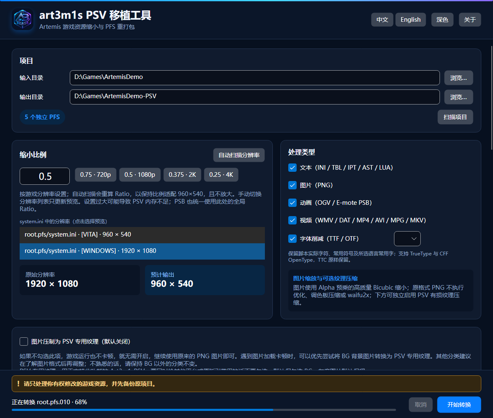

# art3m1s_psv_port_tool

[简体中文](README.md) · [English](README.en.md) · [更新日志](CHANGELOG.md)

[](https://github.com/DeQxJ00/Art3m1sPsvPortTool/actions/workflows/ci.yml)
[](https://github.com/DeQxJ00/Art3m1sPsvPortTool/actions/workflows/release.yml)

面向 Artemis 引擎游戏的 PSV 移植辅助工具。它逐个解包物理 PFS、按选择缩小资源，再以相同文件名重新打包；根目录下 PFS 之外任意名称的文件夹也会完整递归复制，并按文件扩展名转换其中资源（至少覆盖 3 层，实际不限制深度）。应用使用 .NET 10、Avalonia 12、C# 14 与 NativeAOT，支持 Windows、Linux 和 macOS。

> 请只处理你有权修改的游戏资源，并先备份原项目。工具不绕过平台签名、加密授权或 DRM。

## UI 截图



[中文深色](docs/screenshots/ui-zh-CN-dark.png) · [English dark](docs/screenshots/ui-en-US-dark.png) · [中文浅色](docs/screenshots/ui-zh-CN-light.png) · [English light](docs/screenshots/ui-en-US-light.png)

## 下载与平台支持

Release 为 `win-x64`、`linux-x64`、`osx-x64` 和 `osx-arm64` 各提供两种带版本号的压缩包：`with-ffmpeg` 包可直接使用，`no-ffmpeg` 包更小、需要自行放置 FFmpeg。Windows/Linux 为 NativeAOT 单文件，macOS 为未签名、未公证的 `.app.zip`；macOS 首次启动可能需要在“隐私与安全性”中手动允许。

### FFmpeg 放置方法

视频和 OGV 转换需要同时提供 `ffmpeg` 与 `ffprobe`。下载 `with-ffmpeg` 包时两者已位于正确位置；下载 `no-ffmpeg` 包时，请使用包含 libdav1d、libx264 和 libtheora 的 GPL Full 构建，并按以下任一方式配置：

- Windows/Linux：在程序所在目录新建 `tools`，放入 `ffmpeg.exe` / `ffprobe.exe`（Windows）或 `ffmpeg` / `ffprobe`（Linux）。也可以直接放在主程序旁。
- macOS：放入 `art3m1s_psv_port_tool.app/Contents/MacOS/tools/`，并为两个文件增加可执行权限（`chmod +x ffmpeg ffprobe`）。
- 所有平台：可分别设置 `ART3M1S_FFMPEG` 和 `ART3M1S_FFPROBE` 为两个程序的完整路径，或把二者加入系统 `PATH`。

查找顺序为环境变量、程序目录的 `tools`、主程序旁、系统 `PATH`。项目提供的 Full 包中，Windows/Linux 使用经校验的 BtbN n9.0 静态二进制，macOS 使用 FFmpeg 9.0.2 等价源码构建；均不包含 nonfree 组件。

## 使用步骤

1. 选择包含 `xxxxx.pfs` 的游戏根目录与不同的输出目录。
2. 点击“扫描项目”确认独立 PFS 数量；也可点击“自动扫描分辨率”，查看所有 INI 分辨率并选择一组预览。
3. 设置 Ratio，勾选文本、图片、动画和视频类型。
4. 开始转换；输出目录已存在时需要再次点击确认覆盖。

转换先写入输出目录同级的专用临时目录，全部成功后再替换目标；取消或失败会清理临时结果。

## 命令行转换与批量脚本（cmdline）

一次调用只转换**一个游戏**：`--input` 是直接包含 PFS 的游戏根目录，`--output` 是这个游戏最终的输出目录。程序不会遍历父目录寻找其他游戏，也不会额外套一层游戏名目录。例如分别传入 `D:\resources\sample01` 和 `D:\converted\sample01`，则 `root.pfs` 直接输出到后者。

不带参数启动仍为图形界面；`--help` 显示帮助，`--version` 显示版本。命令行不打开 UI，也不读取 UI 保存的设置。请只处理你有权修改的游戏资源，并先备份原项目。

### 统一默认预设

`--preset ui-defaults` 使用与 UI 首次启动相同的转换默认值，省略时也使用此预设。二者共用 `ConversionDefaults`，但命令行不读取 UI 已保存的个性化设置；显式传入的参数覆盖预设，且不受 `--preset` 的前后位置影响。

默认值：Ratio **0.5**；文本、图片、动画、视频全部开启；图片 PSV 纹理转换开启（扫描后采用建议的 AUTO Swizzled）；保留背景 Alpha；PSB 为 DXT5 / Swizzled，独立缩放和渲染补偿关闭；忽略 PFS 内普通视频；并行度、文件名编码为自动；字体削减关闭，字体范围为简体中文。已有输出的跳过 / 覆盖策略属于命令行运行策略，仍由 `--existing` 单独控制。

按“只勾选字体削减、简体中文，其余默认”测试时，只需：

```powershell
.\Art3m1s.PsvTool.App.exe --convert --input "D:\resources\sample01" --output "D:\converted\sample01" --preset ui-defaults --subset-fonts true --font-profile simplified | Out-Host
```

不需要再罗列其他开关；默认不会因扫描到 720p、2K 或 4K 而改变 Ratio。需要类似 UI“自动扫描分辨率”后的适配比例时，明确传 `--ratio auto`。

### 单个游戏调用

Windows PowerShell（在解压后的程序目录执行；管道让 GUI 类型 EXE 的输出可见，并等待退出）：

```powershell
.\Art3m1s.PsvTool.App.exe --help | Out-Host
.\Art3m1s.PsvTool.App.exe --convert --input "D:\resources\sample01" --output "D:\converted\sample01" --dry-run | Out-Host
.\Art3m1s.PsvTool.App.exe --convert --input "D:\resources\sample01" --output "D:\converted\sample01" --ratio 0.5 --subset-fonts false | Out-Host
$LASTEXITCODE
```

Windows CMD 可这样等待完成：

```bat
start "" /b /wait "Art3m1s.PsvTool.App.exe" --convert --input "D:\resources\sample01" --output "D:\converted\sample01" --ratio 0.5 --subset-fonts false
echo %ERRORLEVEL%
```

Linux 直接执行 `./Art3m1s.PsvTool.App --convert --input /data/sample01 --output /data/output/sample01`；macOS 使用 `.app/Contents/MacOS/Art3m1s.PsvTool.App`。支持空格路径（需引号）、`--参数=值` 及位置参数 `--convert 游戏目录 输出目录`。`--batch-convert` 保留为别名，行为同样是**单个游戏**，不再处理总文件夹，不支持待办清单和继续下一个游戏参数。

### 参数

| 参数 | 默认值 / 说明 |
| --- | --- |
| `--preset ui-defaults` | 默认预设，转换参数与 UI 首次启动一致；可省略 |
| `--input PATH` / `-i PATH` | 必填，单个游戏根目录，直接包含 PFS 文件 |
| `--output PATH` / `-o PATH` | 必填，该游戏的最终输出目录，不自动追加游戏文件夹名；不可与输入重合或互相包含 |
| `--ratio auto\|R` | `0.5`，与 UI 初始值一致；`auto` 为显式启用自动适配；手动值为 `0 < R ≤ 1`，小数点使用 `.` |
| `--source-resolution WxH` | 指定该游戏的原始分辨率，例如 `1920x1080`；不修改源文件 |
| `--fit WxH` | `960x540`；仅自动 Ratio 使用的目标边界，不强行改变长宽比 |
| `--types LIST` | `all`；也可 `none` 或 `text,images,animation,video` 的逗号分隔子集 |
| `--parallel auto\|N` | `auto` = `max(1, CPU 逻辑核心数 - 1)`，或正整数；该游戏内部的并行度 |
| `--encoding auto\|utf-8\|shift-jis` | `auto`，PFS 文件名编码 |
| `--native-textures true\|false` | `true`，自动扫描并选择建议转换的普通图片分类，使用安全的 AUTO 规则 |
| `--ignore-bg-alpha true\|false` | `false`，是否忽略背景图片 Alpha；谨慎开启 |
| `--psb-format dxt5\|pvrtc2-4\|pvrtc2-2\|preserve` | `dxt5`；`preserve` 不做 PSB 纹理格式压缩，但勾选动画时仍按全局 Ratio 缩放 PSB |
| `--dxt5-layout swizzled\|linear` | `swizzled`；同时控制普通图片的自动推荐排列和 PSB DXT5 排列 |
| `--subset-fonts true\|false` | `false`，与 UI 一致；独立于 `--types`，不需要削减字体请明确传 `false` |
| `--font-profile simplified\|japanese\|traditional` | `simplified`，分别保留简体 / 日文 / 繁体常用范围 |
| `--ignore-pfs-videos true\|false` | `true`，忽略 PFS 内普通视频，不包含 OGV；PFS 内 DAT 仍按现有规则保留 |
| `--existing skip\|error\|overwrite` | `skip`，已有输出跳过 / 记为失败 / 整个替换；`overwrite` 不交互确认，谨慎使用 |
| `--log PATH` | 自定义完整日志（UTF-8 追加）；默认按输入游戏目录名分组，见下文；警告 / 错误另存相邻的 `.errors.log` |
| `--dry-run` | 只扫描并显示该游戏的分辨率、Ratio 和输出尺寸，不转换、不创建输出或日志；不验证全部贴图和视频的可转换性 |
| `--verbose` | 控制台显示每次进度；完整文件日志始终记录全部资源及完整异常，不受控制台节流影响 |
| `--help` / `-h`、`--version` | 显示帮助 / 版本，不转换 |

自动 Ratio 优先选首个有效 `system.ini` 的 `[WINDOWS]` 宽高，否则选首组，再用扫描所得图片分辨率兜底；计算 `min(1, fit宽/源宽, fit高/源高)`。例如 1920×1080 → 0.5。无法识别时该游戏报错，可用 `--source-resolution 1920x1080` 或 `--ratio 0.5`；只有手动 Ratio 且无法识别原尺寸时，仍缩放资源，但无法预先确定统一 INI 的目标宽高。PSB 独立贴图 Ratio 功能仍禁用，统一跟随全局 Ratio。

`--native-textures false` 只关闭普通图片原生纹理压制，不关闭 PNG 尺寸缩放；图片缩放由 `--types` 的 `images` 控制。PSB 处理由 `animation` 和 `--psb-format` 控制。未选中的资源通常原样复制，但 `system.ini` 缺失的 `[VITA]` 仍按规则追加。视频所需 FFmpeg 放置方式与 UI 相同，见上文。

### 用脚本批量调用

明确列出每个游戏的输入、输出和 Ratio，源目录可以在不同磁盘，不要求放到同一个总文件夹。以下 PowerShell 顺序调用，失败会记录并继续，取消时停止；如需遇错即停，可把失败分支改为 `break`。

```powershell
$tool = ".\Art3m1s.PsvTool.App.exe"
$jobs = @(
    @{ Input = "D:\resources\sample01"; Output = "D:\converted\sample01"; Ratio = "0.5" },
    @{ Input = "E:\source\sample02"; Output = "D:\converted\sample02"; Ratio = "0.75" }
)
$failed = 0
foreach ($job in $jobs) {
    & $tool --convert --input $job.Input --output $job.Output --ratio $job.Ratio --subset-fonts false | Out-Host
    $code = $LASTEXITCODE
    if ($code -ne 0) {
        $failed++
        Write-Warning "Conversion failed: $($job.Input), exit=$code"
        if ($code -eq 130) { break }
    }
}
if ($failed -gt 0) { throw "$failed conversion(s) failed." }
```

也可以把下面保存为 EXE 同目录的 `.cmd`，逐个调用，失败立即停止：

```bat
@echo off
start "" /b /wait "%~dp0Art3m1s.PsvTool.App.exe" --convert --input "D:\resources\sample01" --output "D:\converted\sample01" --ratio 0.5 --subset-fonts false
if errorlevel 1 exit /b %ERRORLEVEL%
start "" /b /wait "%~dp0Art3m1s.PsvTool.App.exe" --convert --input "E:\source\sample02" --output "D:\converted\sample02" --ratio 0.75 --subset-fonts false
exit /b %ERRORLEVEL%
```

### 输出安全与退出码

输出已存在时默认跳过。可用 `--existing error` 改为报错，或 `--existing overwrite` 无提示替换**指定的整个输出目录**，请谨慎使用。沿用核心临时目录和原子发布机制，失败或取消不发布半成品，已有输出保持不变。Ctrl+C 取消当前转换，是否继续其他游戏由调用脚本控制。

锁文件仍位于指定输出目录旁，例如 `result.conversion.lock`，退出后保留，以独占打开的方式防止多个进程同时转换到同一输出目录，无需手动删除。自定义日志不可位于输入或输出目录内。命令行路径不支持符号链接 / junction。

退出码：`0` 成功 / 跳过 / 预览；`1` 转换失败（包括误把多个游戏的父目录作为输入）；`2` 参数、路径、日志或锁初始化错误；`130` 用户取消。程序内部没有游戏队列或待办清单。字体削减与 UI 一样默认关闭；本项目的默认配置转换验收会显式使用 `--subset-fonts true --font-profile simplified`，其余使用共享默认值。

### 日志与错误定位

UI 与命令行的转换都保存完整日志，按**输入游戏根目录名**分组，不按输出文件夹名。默认路径为 `输出父目录/logs/游戏名/`，每次运行使用时间戳和独立编号，例如：

```text
D:\converted\logs\sample01\
  sample01-20261022-153000000-a1b2c3d4.log
  sample01-20261022-153000000-a1b2c3d4.errors.log
```

- `.log`：完整记录每个资源、保留 / 转换结果、字体削减前后字节数、有效参数、阶段、耗时和最终退出状态；只有控制台进度节流，文件记录不丢弃。
- `.errors.log`：出现警告或错误时才创建；同时保留在完整日志中。异常类型、调用栈、所有内层异常及 FFmpeg 原始 stderr 始终保存，不要求 `--verbose`。FFmpeg 命令、退出码、重试和 DAT 原样保留原因也会记录。
- 每条记录包含时间、级别、游戏名、运行编号、阶段、PFS 名（散装资源标记为 loose）和资源路径。并行任务各自报告的错误会分别记录。
- 普通图片及 E-mote PSB 图集的宽或高**超过 4096**时记录原尺寸、缩放后尺寸、上限及图集名：源图超过但目标不超过，记为 `SOURCE_DIMENSIONS_GT_4096` 信息；目标仍超过，记为 `TARGET_DIMENSIONS_GT_4096` 警告。不自动改 Ratio 或裁图。普通图片可能缩放后继续保留 PNG；这不代表 PSV 能正常加载。PSB Swizzled 编码若因此失败，会保留完整错误并取消本次输出发布。
- 初始化 / 参数错误若尚不能打开指定日志，会回退至系统应用数据目录的 `art3m1s_psv_port_tool/logs/游戏名/`（Windows 为 `%LOCALAPPDATA%` 下）；没有可识别输入名时用 `command-line`。无法写入日志也会明确报告，不能静默忽略。UI 日志框、CLI 输出会显示实际日志路径。
- `--log PATH` 自定义完整日志时，错误文件为同目录的 `文件名.errors.log`；多次调用追加，使用运行编号区分。`--dry-run` 始终不创建日志或错误文件，初始化失败也一样。

警告 / 错误日志可能包含已恢复的 FFmpeg 编码重试，不能仅凭该文件存在就断定整体失败；应查看完整日志最后的 `RUN_END`，其中有 outcome、exit-code、耗时和警告 / 错误事件数。

## Ratio 与 PSV 分辨率建议

默认 `0.5`，允许输入 `0 < Ratio ≤ 1`。参考按钮为 `0.75 · 720p`、`0.5 · 1080p`、`0.375 · 2K`、`0.25 · 4K`。以“原游戏分辨率 × Ratio”接近 PSV 的 `960×540`（或 `960×544`）为宜；设置过大会增加显存和内存压力。“自动扫描分辨率”列出游戏根目录及所有 PFS 内 `system.ini` 的完整宽高，标明来源和段落；默认优先选择首个有效 INI 的 `[WINDOWS]`，否则选其第一组，点击其他项可切换预览。扫描只读取 PFS 索引和目标条目，不解包整个归档；仍无法识别时可参考解包后的 `image/bg` PNG。点击自动扫描后，会按默认选中的宽高计算 `Ratio = min(1, 960/宽, 540/高)`，保持长宽比、适配 960×540，且不放大；例如 1920×1080 → 0.5、1280×720 → 0.75。未找到有效宽高时保留当前 Ratio。手动切换列表仅更新预览，可直接修改 Ratio。独立 PSB 比例不受影响。分辨率和 PSB 扫描均保留主页面滚动位置，日志只在框内自动滚动到底部。

## 资源处理规则

“PSB 贴图分辨率与独立缩放”的标题显示为灰色，**扫描按钮和独立 Ratio 控件均已禁用，不能开启。** 分类旧参数不参与转换；PSB 贴图、坐标、origin、画布和运动路径统一跟随全局 Ratio。需勾选动画处理；高级设置的 PSB 纹理格式转换仍独立可用。

整个 PSB 框移到页面最底部（高级设置和日志之后），统一显示为灰色禁用样式；“PSB 渲染补偿比例”及说明也放在框内，不再位于高级设置中。独立缩放未勾选时，渲染补偿也显示为未勾选。全局统一缩放不需要额外补偿，软件不会输出 `art3m1s_psb_render.json`。原配置接口文档保留供参考，见 [PSB 渲染配置](docs/psb-render-config.md)。

保留已保存的分类参数，但当前无法从界面扫描，也不恢复独立缩放开启状态、不采用分类参数转换。自动扫描游戏分辨率不受影响。请从原始资源转换；已带本工具渲染配置的输入会被拒绝，避免重复缩放或沿用失效配置。

- 文本：INI / TBL / IPT / AST / LUA 严格复刻 VisualNovelUpscaler 的 Artemis 匹配、取整、编码与输出行为；IET 原样复制。坐标含尾随全角数字时，仅缩放前面的半角数值：Ratio 0.5 时 `960４` → `480４`、`-640３` → `-320３`；全角后缀逐字保留，纯全角数字不转换，其他正常坐标继续处理，不因此中断转换，并记录保留内容所在行号。INI 平台分辨率统一不会二次覆盖此类字段。E-mote 会额外同步缩放 TBL 姿态表中的 X/Y 偏移与画布宽高、AST 坐标以及 LUA 的固定 `mulpos()` 坐标；人物缩放倍率、动作、表情、口型采样和资源名保持不变。
- 图片：PNG 使用 ImageSharp 的 Alpha 预乘高质量 Bicubic，默认缩放；保留 PNG 时不进行 PNG 优化、调色板压缩或 waifu2x。下方 PSV 纹理选项可启用有损压缩。
- 动画：OGV 使用 FFmpeg Bicubic；目标宽高与 VisualNovelUpscaler 一样分别按 `int(原尺寸 × Ratio)` 截断，保持帧率与音频。Artemis／E-mote 动态立绘 PSB（v1–v4）支持内嵌 `RGBA8` / `DXT5` / `DXT5_SWIZZLED` / `PVRTC2_4BPP` / `PVRTC2_2BPP` atlas，以 Bicubic 按 Ratio 缩小并重建资源表，同时缩放 texture 尺寸、裁切尺寸、icon 矩形、origin、screenSize、动作坐标、偏移、运动路径与空白网格域；角度、动作时间、缩放倍率、曲线和参数范围保持不变。高级设置的“E-mote PSB 纹理格式转换”默认开启，格式默认 `DXT5 (BC3)`，可改为 `PVRTC2 4bpp` / `PVRTC2 2bpp`；关闭则保留原纹理格式，动画勾选项仍控制是否缩放。已有目标格式且无需缩放时不会重复编码。散装及 PFS 内 PSB 使用相同逻辑，固定逐个处理以控制峰值内存。
- 视频：默认勾选“忽略 PFS 内的视频（WMV / DAT / MP4 / AVI / MPG / MKV）”，这些 PFS 条目保持原文件名和原始字节，不交给 FFmpeg；OGV 不在此忽略范围内，仍按动画规则处理。取消勾选后可处理 PFS 内受支持的视频，但 PFS 内 DAT 仍因可能是字体缓存等普通数据而原样保留。PFS 外散装目录中的 WMV / DAT / MP4 / AVI / MPG / MKV 视频统一输出为同名 MP4（H.264 Main@3.1、AAC）；除 DAT 固定为 960×544 外，其余格式使用 Ratio 尺寸截断规则。无法检测到视频流的普通数据 DAT 原样保留。
- 字体（可选）：支持 TTF 与 OTF。TrueType `glyf` 字体使用内置保守削减器，CFF OpenType 字体使用 HarfBuzz 子集器；按简体中文、日文或繁体中文常用范围裁剪，同时始终保留脚本中实际出现的字符、ASCII、常用标点与全角/半角符号。TTC 为避免损坏会原样保留。
- 未勾选类型按字节复制，不执行转换。

并行度默认为 `max(1, CPU 逻辑核心数 - 1)`；OGV 动画固定逐个单线程转换，其他视频任务最多同时两个。

### PSB 纹理格式选择

在高级设置开启“E-mote PSB 纹理格式转换”，下方选择格式；新设置和旧配置都默认 `DXT5 (BC3)`，选择后会保存。格式选择不启用独立 Ratio：贴图与相关几何仍统一跟随全局 Ratio。

旁边的“计算大小”按钮异步读取全部 PFS 和散装 PSB 元数据，不解包整个归档、不修改资源。显示原/目标纹理数据总大小，并按完整宽 × 高和格式列出明细；一份 PSB 的全部图集都会计入，共享像素资源只计一次。按全局 Ratio、所选 DXT5 排列或 PVRTC2 格式计算块对齐与补齐空间，扫描后更改选项会即时重算；动画未勾选时不缩放（Ratio 1），关闭格式转换时保留原格式及排列。无法读取、非 E-mote、含不支持格式或尺寸越界的 PSB 明确列为未计入，错误文件同时写入日志。结果不含 PSB 表、容器头、GPU 分配对齐和缓存，不等于整份 PSB 文件大小或游戏总显存；源文件改变后请重新计算。此按钮不会启用页面底部已禁用的独立比例/扫描功能，也不会自动滚动主页面。

| 输出格式 | 位率 | 像素资源长度（不含 mipmap） | PSB `texture.type` |
| --- | --- | --- | --- |
| DXT5 (BC3) · Swizzled（默认） | 8bpp | `P(宽) × P(高)`，`P(n)` 为不小于 `max(4,n)` 的最小 2 的幂 | `DXT5_SWIZZLED` |
| DXT5 (BC3) · Linear | 8bpp | `ceil(宽/4) × ceil(高/4) × 16` | `DXT5` |
| PVRTC2 4bpp | 4bpp | `ceil(宽/4) × ceil(高/4) × 8` | `PVRTC2_4BPP` |
| PVRTC2 2bpp | 2bpp | `ceil(宽/8) × ceil(高/4) × 8` | `PVRTC2_2BPP` |

三种格式均支持 Alpha，但都是有损压缩，2bpp 更容易丢失颜色、边缘与透明度细节。PVRTC2 由随包 PVRTexLib 编码，保持原始线性块排列。PSB 像素资源不带 DDS / PVR 头；更新字符串表、资源长度及偏移，保留逻辑宽高和其他字符串。[PVRTC2 存储格式](https://github.com/KhronosGroup/DataFormat/blob/main/pvrtc.txt)。

DXT5 的“排列模式”默认 **Swizzled · GXM Morton**，也可选 **Linear**；未保存过该项的旧配置同样默认 Swizzled。按整个 16 字节 BC3 块重排，Y 位先交织、X 位后交织，矩形的较短边位用尽后继续较长边。存储宽高各自向上补至 2 的幂，最小 4；补齐块为零，逻辑尺寸、icon 和几何不因排列再缩放。仅切换排列时不解码或重新压缩，支持精确反重排。Swizzled 支持逻辑宽高 1–4096；超过范围会明确失败。该选项只作用于 PSB DXT5，选择 PVRTC2 或关闭格式转换后不可用，不改变普通 DDS/PVR 输出。关闭格式转换会保留原 PSB 的格式和排列。

**兼容性：当前 GXM 的 E-mote PSB 加载器只识别 RGBA8 / 线性 DXT5；`DXT5_SWIZZLED` 和 PVRTC2 均需引擎另行支持。不能把 Swizzled 数据伪装成 `DXT5`，也不能由引擎再次重排。本项目不直接修改引擎；配套支持完成前请手动选择 DXT5 + Linear。** 接入说明见 [DXT5 排列约定](docs/psb-dxt5-layout.md) 和 [PVRTC2 格式约定](docs/psb-pvrtc2-format.md)。

### PSB DXT5 显存占用与压缩原因

RGBA8 每像素 4 字节；DXT5（BC3）每个 `4×4` 像素块占 16 字节，支持渐变透明。图集像素数据大小分别为 `宽 × 高 × 4` 和 `ceil(宽/4) × ceil(高/4) × 16`，所以通常同尺寸 DXT5 数据约为 RGBA8 的四分之一。它是有损压缩，颜色和 Alpha 都是近似值，不是无损保留透明度。[格式说明：Microsoft Learn](https://learn.microsoft.com/en-us/windows/win32/direct3d11/texture-block-compression-in-direct3d-11)。

这不仅是缩小磁盘文件：当前 Art3m1sPSV 的原生 BC3 路径直接上传压缩块并由 GPU 采样，不保存完整 RGBA 像素副本，主要为节省纹理显存和传输量。与缩小分辨率结合后收益更大，但不保证提高帧率；不支持原生 BC3 而回退为 RGBA 解码时，显存收益可能消失。

| 图集尺寸 / Ratio | RGBA8 数据 | DXT5 Linear 数据 | 当前 GXM DXT5 分配估计 |
| --- | ---: | ---: | ---: |
| 4096 × 2048 / 1 | 32 MiB | 8 MiB | 8 MiB |
| 3072 × 1536 / 0.75 | 18 MiB | 4.5 MiB | 8 MiB |
| 2048 × 1024 / 0.5 | 8 MiB | 2 MiB | 2 MiB |
| 1024 × 512 / 0.25 | 2 MiB | 0.5 MiB | 0.5 MiB |

以上 Ratio 均相对于 `4096 × 2048` 原图。当前引擎的 BC3 存储宽高分别向上补至 2 的幂（最小 4），RGBA 行宽对齐到 8 像素，单次纹理内存分配均向上对齐到 **256 KiB**。因此非 2 的幂尺寸不能直接按“每像素 1 字节”当作实际显存；小贴图的 RGBA8 和 DXT5 都可能至少分配 0.25 MiB，格式压缩不一定减少分配量。

表中“DXT5 数据”及禁用分类区块的旧数据比较按 **Linear** 统计。Swizzled PSB 提前包含 2 的幂存储补齐，例如 3072×1536 的像素资源为 8 MiB，而不是 Linear 的 4.5 MiB；不包含额外的 256 KiB GPU 分配对齐，重排本身不会降低显存。

软件分组行显示的是所选 Ratio 下**单张最大图集**的 RGBA8 / DXT5 对比，不是所选输出格式的实测显存，也不是整份 PSB 或所有扫描文件的总占用。多图集只按实际同时加载的纹理逐张累加，缓存、渲染目标和临时内存等另计。此估算针对当前原生 GXM 路径、尺寸不超过 4096 且不含 mipmap 的图集；其他引擎或回退路径可能不同。`1 MiB = 1024 × 1024` 字节。

## PSV 原生压缩纹理

“图片压制为 PSV 专用纹理”总开关首次启动默认勾选，后续恢复上次选择；已有配置中明确关闭的状态仍保留。若同一份资源还要给其他平台或原版引擎使用，请关闭此项。需要包含 DDS/PVR 加载支持的 Art3m1sPSV 版本；这不是所有原版 PSV 引擎通用的转换。

点击“扫描图片分类”读取全部有效 `.pfs` / `.pfs.xxx`（含子目录）及散装 PNG/JPEG/DDS/PVR。按真实目录生成分类，列出数量、透明度、文件和估计大小。扫描后，AUTO 识别到有可转换图片的分类（BG/FG/CG 等）自动勾选，默认使用 AUTO Swizzled；灰度独立归类，UI、未知目录、带偏移信息、已有原生纹理及不适合转换的图片仍保留。扫描不会自动打开纹理转换总开关；重新扫描保留已有分类的勾选和格式设置，新分类按识别结果勾选。每类可选自动、保留或具体格式。下拉框按实际图片及缩放后的尺寸标注“不适合 X/N 张”和原因；这些图片在转换时保留并记录原因，不强制丢弃通道。

自动策略：普通 AUTO 和“除带偏移信息外的 AUTO 转换（仅手动）”均提供 **Swizzled（优先/默认）** 与 **Linear**。Swizzled AUTO 对不透明彩色图使用 BC1 Swizzled，透明图使用 BC3 Swizzled；Linear AUTO 使用相应的线性格式。普通 AUTO 保留灰度、UI、未知目录和已有原生纹理；手动模式仅放宽所选分类的目录限制，仍保护灰度和 metadata。“转换 BG 时忽略透明度”独立可选，默认关闭；开启会丢弃 BG 的 Alpha。与引擎运行时设置不同，它会改变输出资源本身。

| 格式 | 位/像素 | 通道/透明度 |
| --- | ---: | --- |
| BC1 / DXT1 · Swizzled / Linear | 4 | RGB + 二值 Alpha |
| BC2 / DXT3 | 8 | RGB + 4-bit Alpha |
| BC3 / DXT5 · Swizzled / Linear | 8 | RGB + 插值 Alpha |
| BC4 UNORM / SNORM | 4 | 单通道 R，无独立 Alpha |
| BC5 UNORM / SNORM | 8 | RG，无蓝色或独立 Alpha |
| PVRTC1 RGB / RGBA 2bpp | 2 | RGB 或 RGBA |
| PVRTC1 RGB / RGBA 4bpp | 4 | RGB 或 RGBA |
| PVRTC2 2bpp / 4bpp | 2 / 4 | RGBA |
| ETC1 | 4 | RGB，无 Alpha |

BC4 只适合显式选择的无透明灰度数据；普通图片的 BC5/有符号格式会标为不适合。PVRTC1 要求缩放后的尺寸为二次幂；不会自动拉伸。ETC1 实机支持，但当前 Vita3K 存在兼容问题。尺寸上限 4096，不生成 mipmap。估计包含块对齐和容器头，保留项暂按原文件大小计算；实际显存有额外对齐/分配开销，输出也不保证小于 PNG。

转换后 BC 使用 DDS、PVRTC/ETC1 使用 PVR，更新 PFS 原始名称的后缀而保留编码，脚本的 PNG 引用由引擎同名查找兼容。重复虚拟路径、同名后缀冲突、已存在的目标和无法检查的图片会保留。带 PNG 文本、偏移、裁剪或未知附加块的图片保留为 PNG，并沿用原 PNG 缩放规则，不丢弃定位信息。PSB 的内嵌图集继续由独立 E-mote 选项处理。

发布包须保留随附的 PVRTexLib 原生库（Windows `PVRTexLib.dll`、Linux `libPVRTexLib.so`、macOS `libPVRTexLib.dylib`）和许可文件。

DDS Swizzled 为 PSV GXM 私有排列：FourCC 保持 `DXT1` / `DXT5`，`DDS_HEADER.dwReserved1` 开头五字节（整个文件 `0x20`–`0x24`）写 ASCII `GXMSW`；无标记按普通 Linear 处理，不增加标记版本或额外头。按 4×4 压缩块 Y-first Morton 重排并向上补齐 2 的幂存储，逻辑尺寸仍跟随 Ratio，补齐不扩大绘制尺寸。Swizzled 文件可能比 Linear 大，预先重排不等于更高压缩率；估计大小已计入存储补齐。**必须使用识别 GXMSW 的配套引擎，旧引擎和普通 DDS 查看器请选 Linear，不能再次 swizzle。** 接入及精确偏移见 [DDS GXMSW 排列约定](docs/dds-gxm-swizzled.md)。本项目不直接修改引擎；PSB 排列独立设置，BC2 / BC4 / BC5 / PVR 不受影响。

## PNG 颜色表与透明度保证

以下适用于保留 PNG 格式的图片。


RGB24 输出仍为 RGB24，不增加 Alpha；RGBA、灰度、透明灰度保持颜色类型。遮罩使用的 Gray8 PNG 强制保持 8-bit 灰度（PNG color type 0），不会转成 RGB、RGBA 或灰度透明格式。索引色保持原 1/2/4/8-bit 位深，原 `PLTE` 与 `tRNS` 块逐字节写回，不修改、重排或删减自带颜色表。Bicubic 结果仅映射回原颜色表并重写像素索引。PNG 坐标文本按 Ratio 缩放；除图像尺寸、像素数据和坐标文本外，其余 PNG 块逐字节保留。

## 构建、测试和 GitHub Actions

需要 .NET SDK 10.0.303：

```powershell
dotnet restore art3m1s_psv_port_tool.slnx
dotnet test art3m1s_psv_port_tool.slnx -c Release
dotnet publish src/Art3m1s.PsvTool.App -c Release -r win-x64
./scripts/generate-screenshots.ps1
```

`ci.yml` 执行 Release 编译、测试、格式、截图基线与多平台 NativeAOT 检查；`release.yml` 在 `v*` 标签或手动触发时构建四个平台，并为每个平台发布带版本号的 `with-ffmpeg` / `no-ffmpeg` 压缩包、校验和、SBOM、许可与 FFmpeg 构建信息。

发布新版本时同步更新 `CHANGELOG.md`、`Directory.Build.props` 和 macOS `Info.plist`，然后打相同版本的 `v*` 标签；CI/Release 会运行 `scripts/check-changelog.ps1` 检查版本与日志条目。

## 已知限制

- ImageSharp 3.1.12 存在已知漏洞。目前仅将 NU1902 / NU1903 保留为非阻断警告，漏洞审计仍启用；这不等于漏洞已修复。请仅处理可信且有权修改的资源，升级修复版 4.x 前需要配置官方许可 key。
- macOS 首版不签名、不公证。
- 无法由容器和原编码支持的音视频流会报告 FFmpeg 原始诊断并停止，不会静默降级。
- pf2/pf6 可读取，但重新打包统一输出 pf8；超 4 GiB 的单个 PFS 条目不支持。
- 当前 PSB 重建支持明文正文以及可自动推导密钥的加密头；加密正文、外置纹理和 `RGBA8` / `DXT5` / `DXT5_SWIZZLED` / `PVRTC2_4BPP` / `PVRTC2_2BPP` 以外的 atlas 格式会明确报错，不会静默复制成“已转换”。块压缩重新编码有损；若新增字符串无法装入原节点索引位宽且没有可复用索引，则明确失败而不破坏输出。
- 自动文本规则面向常见 Artemis 脚本，发布前仍应在真实游戏中检查字幕、点击区域与动画坐标。

## Credits

感谢以下开源项目。

| 项目 | 许可证 | 在本项目中的用途 | 来源 |
|---|---|---|---|
| **pfs_upk** | GPL-3.0 | pf2 / pf6 / pf8 格式及打包、解包行为参考 | [nextgal/pfs_upk@abdffcb](https://github.com/nextgal/pfs_upk/tree/abdffcbeb3c733ce234aa99ed42b206d13aaed2f) |
| **art3m1s-core** | MPL-2.0 | E-mote PSB v1–v4 结构、加密头、对象及资源表解析参考 | [Alphaly2K/art3m1s-core@0c06f37](https://github.com/Alphaly2K/art3m1s-core/tree/0c06f37160961c9ff75d4937d5e6bb0500d0bef9) |
| **VisualNovelUpscaler** | MIT | Artemis 文本坐标、尺寸与 Ratio 处理规则参考； | [hokejyo/VisualNovelUpscaler@d755913](https://github.com/hokejyo/VisualNovelUpscaler/tree/d755913eb72f739ad4faea70e689cf933ba54c7f) |
| **Avalonia** | MIT | 跨平台桌面 UI（12.1.2） | [AvaloniaUI/Avalonia](https://github.com/AvaloniaUI/Avalonia) |
| **PVRTexLib.NET / PVRTexLib** | MIT wrapper / PowerVR Tools EULA | GXM 纹理编码 | [PVRTexLib.NET](https://github.com/YingFengTingYu/PVRTexLib.NET) · [PowerVR EULA](https://developer.imaginationtech.com/terms/software-end-user-licence-agreement/) |
| **SixLabors.ImageSharp** | Six Labors Split License 1.0 | PNG 解码与 Bicubic 缩放（3.1.12） | [SixLabors/ImageSharp](https://github.com/SixLabors/ImageSharp) |
| **HarfBuzz** | Old MIT | CFF OpenType 字体削减（8.3.1） | [harfbuzz/harfbuzz](https://github.com/harfbuzz/harfbuzz) |
| **Optris.StaticGraphics.Avalonia.Software** | MIT fork 及上游组件许可证 | NativeAOT 静态 Skia / HarfBuzz 图形后端 | [NuGet](https://www.nuget.org/packages/Optris.StaticGraphics.Avalonia.Software) |
| **FFmpeg / ffprobe** | GPL Full 构建 | 动画与视频探测、缩放及转码（n9.0 / 9.0.2） | [FFmpeg 9.0.2 源码](https://ffmpeg.org/releases/ffmpeg-9.0.2.tar.xz) |
| **BtbN/FFmpeg-Builds** | GPL-3.0 | Windows/Linux FFmpeg Full 静态二进制与官方校验和 | [BtbN/FFmpeg-Builds](https://github.com/BtbN/FFmpeg-Builds) |
| **dav1d** | BSD-2-Clause | AV1 软件解码 | [VideoLAN/dav1d](https://code.videolan.org/videolan/dav1d) |
| **x264** | GPL-2.0 | H.264 编码 | [VideoLAN/x264](https://code.videolan.org/videolan/x264) |
| **libtheora** | BSD-3-Clause | Theora 编码 | [Xiph.Org/libtheora](https://github.com/xiph/theora) |
| **libogg** | BSD-3-Clause | Ogg 容器 | [Xiph.Org/libogg](https://github.com/xiph/ogg) |
| **zlib** | Zlib | PNG 帧序列压缩 | [zlib](https://zlib.net/) |

This product includes components of the PowerVR Tools Software from Imagination Technologies Limited.
